<p align="center">
  
</p>

<h3 align="center">I build software that keeps its receipts.</h3>

<p align="center">
  AI decisions you can rerun. Tablets you can wipe with a certificate.<br />
  Data leaks you can prove closed. Bills settled to the last unit.
</p>

<p align="center">
  <a href="https://miracle-20cp.onrender.com/">Portfolio</a>&nbsp;&nbsp;·&nbsp;&nbsp;
  <a href="https://x.com/0xMiiracle">X</a>&nbsp;&nbsp;·&nbsp;&nbsp;
  <a href="https://www.linkedin.com/in/miracle352/">LinkedIn</a>&nbsp;&nbsp;·&nbsp;&nbsp;
  <a href="mailto:miracledoxxed@gmail.com">Email</a>
</p>

<br />

## Itemized

Every project here ends in something you can check. This is what each one hands you.

<table>
  <tr>
    <td width="50%" valign="top">
      <h3><a href="https://github.com/miracle352/choiceproof">Choiceproof</a>&nbsp; </h3>
      <b>Asks:</b> did the AI change its answer, and did you mean it to?<br /><br />
      <b>Receipt:</b> the exact inputs, both responses, a human label, and saved cases you can rerun against the next revision.<br /><br />
      <code>Next.js</code> <code>PostgreSQL</code> <code>Vitest</code> <code>OpenServ</code><br /><br />
      <a href="https://choiceproof.vercel.app/">Open it</a> · <a href="https://github.com/miracle352/choiceproof#readme">How it works</a>
    </td>
    <td width="50%" valign="top">
      <h3><a href="https://github.com/miracle352/lastcopy">LastCopy</a>&nbsp; </h3>
      <b>Asks:</b> is it safe to wipe this field-survey tablet?<br /><br />
      <b>Receipt:</b> one answer per device (safe to wipe, recover first, or hold) with a hashed clearance certificate anyone can re-check in the browser.<br /><br />
      <code>Python</code> <code>Agents</code> <code>Nemotron</code> <code>Zetaris</code><br /><br />
      <a href="https://lastcopy-five.vercel.app">Open it</a> · <a href="https://lastcopy-five.vercel.app/verify">Verify a certificate</a> · <a href="https://github.com/miracle352/lastcopy#readme">Code</a>
    </td>
  </tr>
  <tr>
    <td width="50%" valign="top">
      <h3><a href="https://github.com/miracle352/blotter">Blotter</a>&nbsp; </h3>
      <b>Asks:</b> did people's personal data leak into production logs, and whose?<br /><br />
      <b>Receipt:</b> a confidential incident record (how many people, which countries, since which merge request) and a Semgrep rule proven against the leak.<br /><br />
      <code>Python</code> <code>FastAPI</code> <code>GitLab Duo</code> <code>Semgrep</code><br /><br />
      <a href="https://blotter-prod.onrender.com/">Closed incidents</a> · <a href="https://github.com/miracle352/blotter#readme">Code</a>
    </td>
    <td width="50%" valign="top">
      <h3><a href="https://github.com/miracle352/flynet-tab-split">FlyTab</a>&nbsp; </h3>
      <b>Asks:</b> who owes what at this table?<br /><br />
      <b>Receipt:</b> one payment request per seat, paid straight to the venue, with BigInt money math and a full activity ledger.<br /><br />
      <code>Next.js</code> <code>TypeScript</code> <code>OAuth PKCE</code> <code>BigInt</code><br /><br />
      <a href="https://github.com/miracle352/flynet-tab-split#readme">Run it locally</a>
    </td>
  </tr>
</table>

## The fine print

- **Evidence over claims.** Inputs, outputs, state changes, and limits should be visible.
- **Exactness where it matters.** Money stays out of floating-point math. AI decisions stay inside explicit boundaries.
- **Honest product states.** Mock, live, private, published, complete, and planned are clearly separated, including the labels on this page.

## Line items

```text
BUILD    TypeScript · Next.js · React · Python · Django · FastAPI
AI       evaluation loops · multi-agent pipelines · human review
DATA     PostgreSQL · evidence capture · regression tests
CHAIN    Solidity · wallets · payment flows · BigInt accounting
SHIP     API design · CI/CD · Semgrep · Vercel · Render
PEOPLE   community growth · launches · partnerships · technical writing
```

## Before the code

I spent 3+ years helping Web3 teams grow communities, coordinate launches, build partnerships, and explain technical products clearly. That operator background is why the workflow matters to me as much as the interface. [See the Web3 operator portfolio →](https://miracle-20cp.onrender.com/)

## Now printing

Public prototypes around trustworthy AI decisions, agent workflows, and on-chain products. Open to focused collaborations where the problem is real and the evidence can be shown.

<br />

<p align="center"><sub>Lagos, Nigeria · available across time zones · reprinted whenever something ships</sub></p>
